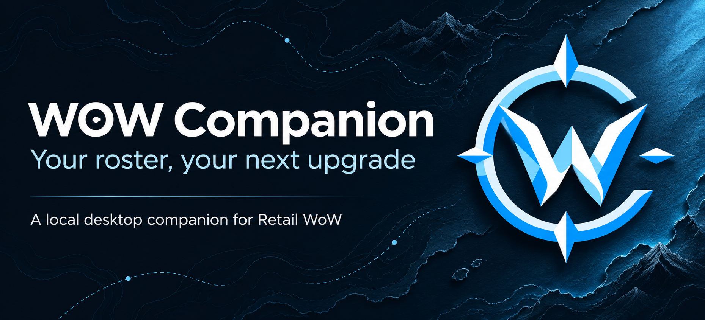
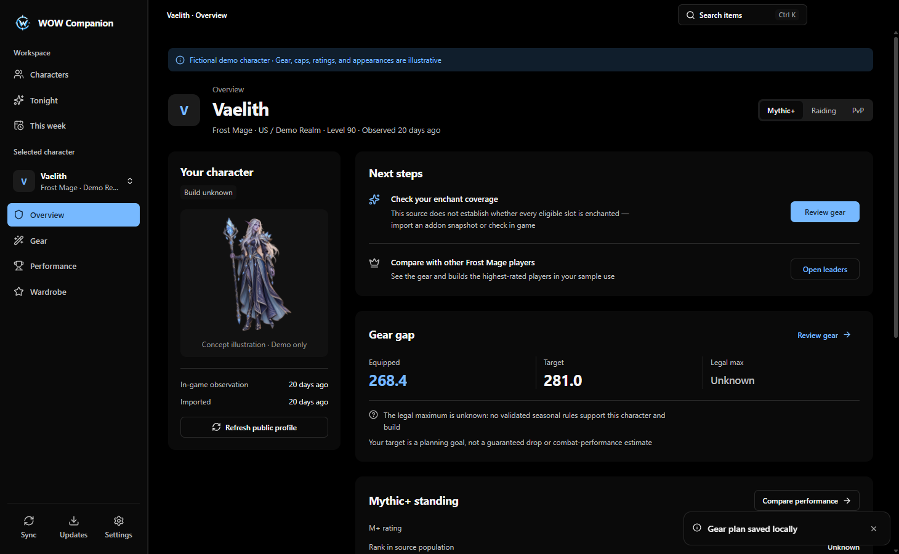
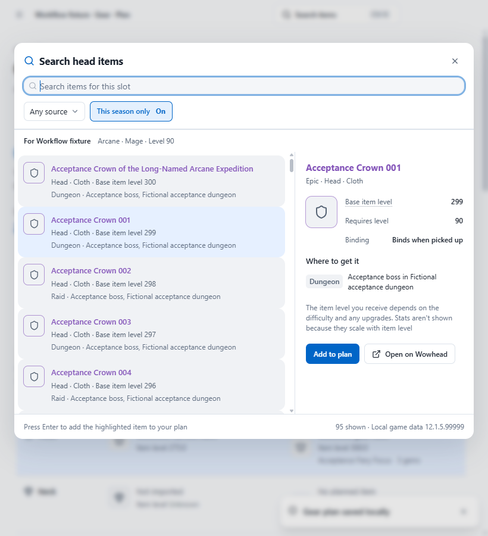

# WOW Companion



A Windows desktop companion for Retail World of Warcraft, built for the time between runs

Keep your characters in one roster, compare equipped gear with your next upgrade, and save plans for items, enchants, gems, and outfits. WOW Companion stores your plans and imported snapshots locally, so you can review them when you're offline

**[Download for Windows x64](https://github.com/dolimight/wow-companion/releases)** · [First-run setup](#first-run-setup) · [Run from source](#run-from-source)

## Install on Windows

You need a Windows x64 PC; an installed Retail WoW client supplies local item data and the companion addon

1. Open [GitHub Releases](https://github.com/dolimight/wow-companion/releases) and choose the newest published release
2. Under **Assets**, download `WOW-Companion-<version>-win-x64.exe`, then run the installer and choose your installation folder
3. Launch **WOW Companion** and follow the setup screen to find your game and add your characters

Published builds currently use the **Nightly** prerelease track. Use the installer `.exe`; `.blockmap`, `.yml`, and checksum files support updates and verification rather than installation
Nightly releases can lag the current source and screenshots shown below

The current Windows packages are unsigned, so Windows may show an unknown-publisher or reputation prompt. Download builds from this repository's releases

Node.js, npm, and a source checkout are only needed if you want to build the app yourself

## First-run setup

### Connect your game and addon

WOW Companion looks for your Retail installation automatically. If it can't find it, use **Choose folder** in setup and select the folder that contains `_retail_`

Choose **Install addon**, then log in to each character you want to track. Type `/reload` or log out normally so WoW writes the addon's saved data, then return to the desktop app and use **Sync**

The app reads the last saved export; it can't force WoW to write data while you're still playing. Manual addon installation and slash commands are documented in the [addon guide](addon/README.md)

### Add characters and optional data connections

You can add a character by name or explore with fictional demo characters. Connecting Blizzard data in setup adds official character pictures and item details, and enables the Battle.net character-import flow; the app guides you through creating your own Blizzard application credentials

Optional connections live under **Settings → Connections**. Local plans and addon imports remain usable without a Blizzard connection, while provider refreshes and online comparisons need internet access

After setup, open **Gear → Plan**, choose a slot, and search for an item by name. Add enchants and gems, then choose **Save plan** to keep your changes. A saved plan is separate from what your character currently wears

## What you can do

- **Track your roster** with character switching, favorites, separate activity views, source timestamps, and reversible archiving
- **Plan upgrades** beside equipped gear, search compatible items with scrolling pagination, and inspect available enchant and gem effects before choosing them
- **Plan tonight's session** around saved goals and time estimates, and review weekly progress, inventory, and mutually exclusive Great Vault choices
- **Compare within context** using public Mythic+ leaders, tracked peers, and local history, with separate Mythic+, Raiding, and PvP views
- **Save appearance and simulation work** with wardrobe plans, outfit codes, SimulationCraft profiles, and report bookmarks; a configured local SimulationCraft engine can run supported comparisons

Choose Light, Dark, or System appearance, plus a classic, nightly, or holiday app icon with a matching primary color. The app remembers your window size and maximized or fullscreen mode between launches

## Inside the app

These are unaltered desktop acceptance captures using fictional characters and items. Demo numbers are illustrative, and the character artwork is a labeled concept illustration

### Character overview

See the character, saved target, and next steps together, with missing data left visible



### Item search

Browse compatible results, inspect sources, and add an item to your plan. Further results load as you scroll



## Updates and saved data

Installed releases check GitHub for desktop updates. Open **Settings → Updates & About** to choose a track, check for updates, and download a release; applying it restarts the app

Stable and Nightly use the same local user-data directory. Stable builds don't automatically consume Nightly releases, and returning to an older Stable can require waiting for a newer Stable version rather than downgrading a database

Your roster, imported snapshots, plans, and preferences live in a local SQLite database under Electron's user-data directory. JSON backup export/import is available in Settings; attached model files need a separate backup. Connection secrets stay outside exported backups

Development builds and isolated acceptance profiles don't fetch desktop updates. See [release channels and publishing](docs/releases.md) for the schedule, verification, and release process

## Scope and current limits

WOW Companion targets **Retail WoW on Windows**. Classic clients, macOS, and Linux release packages aren't supported by the current release workflow

Seasonal ceilings require a validated ruleset for the character's game build; unsupported values stay **Unknown**. Personal item-level targets are planning goals, and a popular item or an incomplete simulation isn't a guaranteed performance improvement

Wardrobe saves appearance intent and can inspect an attached self-contained GLB model. It doesn't assemble a live Retail character model with dynamic armor swaps

Public profiles can be private or unavailable, and comparison results retain their source and sample scope. Live authenticated provider behavior and the addon still need real-account and in-game verification beyond the deterministic desktop tests

The [implementation status](docs/roadmap-implementation-2026-10-29.md) documents the shipped workflows and remaining release gates

## Run from source

Use **Node.js 24.18 or newer** and **npm 11 or newer**

```powershell
git clone https://github.com/dolimight/wow-companion.git
cd wow-companion
npm ci
npm run dev
```

The app starts with an empty workspace; add your characters or choose demo data in the interface

To build an unpacked Windows app or an installer:

```powershell
npm run package:win
# Open release/win-unpacked/WOW Companion.exe

npm run dist:win
# Installer output is under release/
```

Keep an unpacked executable together with its sibling files. Use the installer when distributing a build

### Verify changes

```powershell
npm run check
npm run test:scripts
npm run build
node --import tsx scripts/integration.ts
npm run test:debug
```

The debugger acceptance command exercises the real Electron main process and sandboxed renderer against a fresh isolated profile. Its printed `.local/debug-acceptance-*` directory contains screenshots, `acceptance/report.json`, and `debugger.json`

For packaged verification, set `WOW_COMPANION_DEBUG_EXECUTABLE` to the absolute path of `release/win-unpacked/WOW Companion.exe` before running `npm run test:debug`. Normal app launches don't enable debugger access

The optional browser development preview uses a separate `.local/browser` database. Run `npm run build`, then `npm run dev:browser`; native dialogs remain desktop-only, and the preview must stay on loopback

## Project notes

Electron hosts a React and TypeScript interface with shadcn Base UI components, TanStack Router/Query/Table, Effect v4, and local SQLite. Worker threads handle the database and game-data index; authenticated tRPC runs on loopback, and the renderer uses context isolation and sandboxing

The project builds and tests with standard npm commands and doesn't require an AI coding assistant, model, or plugin

Changes go through feature branches and pull requests with required GitHub checks. See [repository guidance](docs/repository.md), [product constraints](PRODUCT.md), and [design guidance](DESIGN.md) before contributing

[Marketing images and their sources](docs/marketing/README.md) · [Download the social card](docs/marketing/wow-companion-social.png) · [App asset provenance](public/assets/README.md)

WOW Companion is an independent project and isn't affiliated with or endorsed by Blizzard Entertainment
